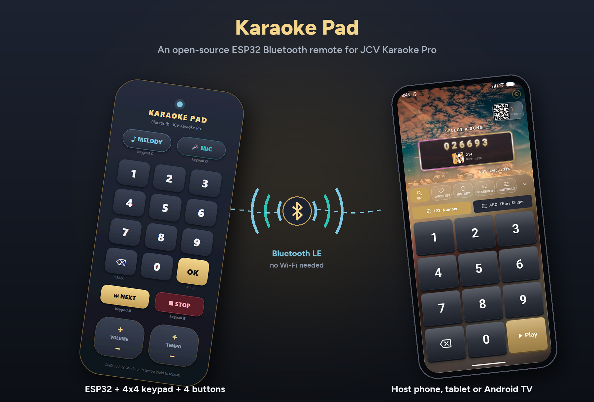
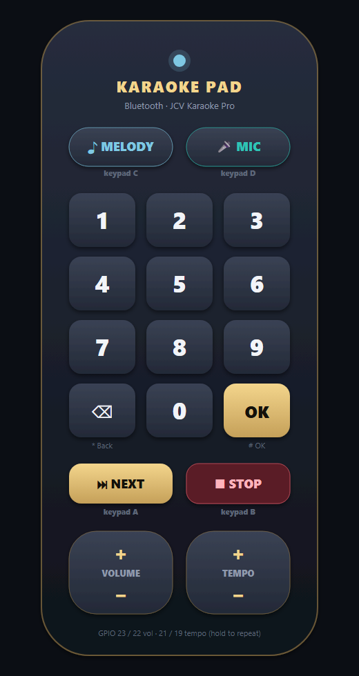
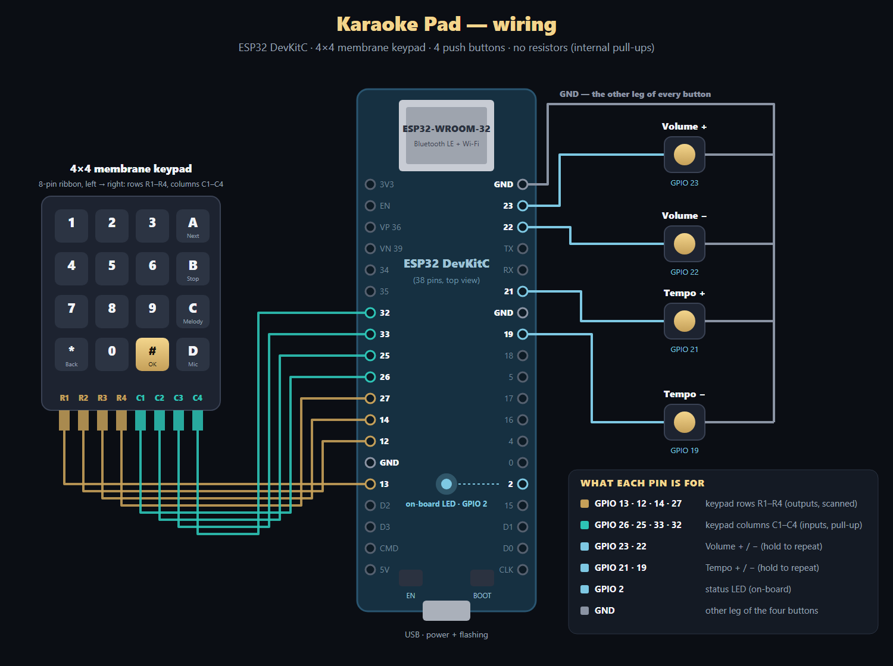

<p align="center">
  
</p>

<h1 align="center">Karaoke Pad</h1>

<p align="center">
An open-source <strong>ESP32 Bluetooth remote</strong> for <a href="https://jcvupdates.duckdns.org/app/kar/">JCV Karaoke Pro</a>:
key in song numbers, OK / Back, Next, Stop, melody, mic, volume and tempo — no Wi-Fi needed.
</p>

<p align="center"><a href="https://github.com/jcvsite/Karaoke_ESP32_Controller">github.com/jcvsite/Karaoke_ESP32_Controller</a> · <a href="https://jcvupdates.duckdns.org/app/kar/esp32.html">build guide</a></p>

---

## What it does

- Connects to a **JCV Karaoke Pro Host** (Android phone, tablet or Android TV) over **Bluetooth Low Energy**.
- Every button press is sent as a Room API action (`digit`, `ok`, `next`, `vol+`…) — the same actions as the Host's Wi-Fi API.
- **Mock mode:** no buttons yet? Flash a bare ESP32 board and type keys in the Serial Monitor (`026693` + Enter keys in the song and presses OK).
- A status LED shows the link: slow blink = waiting to be found, fast blink = waiting for the Host to allow it, on = ready.

## Parts

| Part | Notes |
|---|---|
| ESP32 dev board | Any classic ESP32 (`esp32dev`, e.g. DevKitC / NodeMCU-32S). Not ESP32-S2 (no Bluetooth). |
| 4×4 membrane keypad | The common 8-pin “matrix keypad”. Optional — leave it out for mock mode. |
| 4 push buttons | Volume + / −, Tempo + / −. Optional. |
| USB cable / battery | USB power, or a 3.7 V Li-ion cell with a charger board. |

## The remote

<p align="center"></p>

| Key | Sends | Key | Sends |
|---|---|---|---|
| `0`–`9` | `digit` | `A` | `next` |
| `*` | `back` | `B` | `stop` |
| `#` | `ok` | `C` | `melody` |
| Vol + / − | `vol+` / `vol-` (repeat while held) | `D` | `mic` |
| Tempo + / − | `tempo+` / `tempo-` (repeat while held) | | |

Change the map in `pressKey()` and `BUTTONS[]` in [`src/main.cpp`](src/main.cpp).

## Wiring

<p align="center"></p>

Gold wires are the keypad **rows**, teal the keypad **columns**, blue the four **buttons**; the grey **GND** wire is the other leg of every button. The drawing is generated by [`docs/make_wiring.py`](docs/make_wiring.py) — change the pins there and in `src/main.cpp` together.

| Keypad pin (left → right) | ESP32 GPIO |
|---|---|
| Row 1 · Row 2 · Row 3 · Row 4 | 13 · 12 · 14 · 27 |
| Col 1 · Col 2 · Col 3 · Col 4 | 26 · 25 · 33 · 32 |

| Button (other leg to GND) | ESP32 GPIO |
|---|---|
| Volume + | 23 |
| Volume − | 22 |
| Tempo + | 21 |
| Tempo − | 19 |
| Status LED | 2 (on-board LED on most boards) |

The buttons use the ESP32's internal pull-ups — no resistors needed. Pins are set at the top of `src/main.cpp`.

## Build and flash

With [PlatformIO](https://platformio.org/) (VS Code extension or CLI):

```bash
pio run                 # build
pio run -t upload       # flash the board (USB)
pio device monitor      # console at 115200 — type ? for help
```

## Pair with the Host

1. On the Host (JCV Karaoke Pro on Android): **Settings › Room — phones and TVs › Bluetooth pads › scan**.
2. Tap **Karaoke Pad**. The Host asks once: allow it. The LED stays on.
3. Press keys — they show on the Host's number frame and the TV.

The Host remembers the pad; next time it connects without asking. Bluetooth pads count toward the Host's maximum number of remotes.

## Mock console

```text
0-9        key in digits            026693  digits + OK
o / b / x  OK / Back / Cancel       n / s   Next / Stop
m / i      Melody / Mic             + / -   Volume up / down
] / [      Tempo up / down          u d l r TV navigation
F / f      lyrics bigger / smaller  G / g   next / previous background
p026693    play song 026693 now     ?       help, status
```

## Protocol (Room API over Bluetooth LE)

| Part | UUID | |
|---|---|---|
| Service | `6b617261-6f6b-11ef-9b5e-0242ac120001` | advertised |
| Identity | `6b617261-6f6b-11ef-9b5e-0242ac120002` | read: `{"v":1,"deviceId":"…","name":"Karaoke Pad"}` |
| Session | `6b617261-6f6b-11ef-9b5e-0242ac120003` | Host writes the pad's status (`pendingController`, `ok`, `error`) |
| Control | `6b617261-6f6b-11ef-9b5e-0242ac120004` | notify: one JSON per press, e.g. `{"action":"digit","digit":"5"}` |

Full reference: [Room API — Bluetooth pads](https://jcvupdates.duckdns.org/app/kar/api.html#bluetooth).

## License

[MIT](LICENSE) © JCV Softwares. JCV Karaoke Pro itself is a separate app with its own terms.
